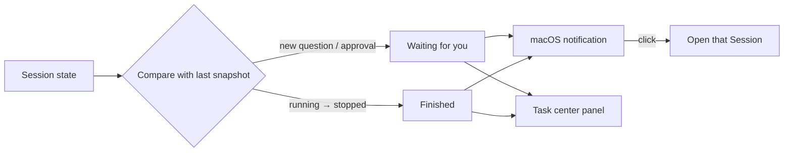

# dsh-task-center

**One sidebar entry for "which project is running what, and which Agent is waiting for me" — with real macOS notifications when you are needed.**

A [DeepSeek Harness](https://github.com/deepseek-ai/deepseek-harness) (DSH) plugin ·
[中文](README.md) · MIT License


---

## The problem

DSH groups Sessions by WorkSpace (project directory). With several projects open at once, three things keep happening:

1. **You forget which project you were just in.** A dozen projects sit side by side; the Session you want is folded inside its project group, and finding it again is a hunt.
2. **An Agent stops to ask you something and you never notice.** Once it asks a question, requests approval, or asks for a plan review, the whole turn waits. In the sidebar that Session only has a tiny dot — if you are in another project or another app, the work quietly stalls.
3. **A task finishes and nobody tells you.** You come back minutes later to find it was done long ago.

This plugin pulls "running / waiting for you / just finished" out of the per-project groups into one cross-project entry, and calls you with a macOS notification when you are away. Clicking the notification opens that Session.

## Features

### 1. A "Task center" entry in the sidebar

It sits at the foot of the sidebar, directly above Settings.

- The number on the right counts the Sessions **waiting for you**; it disappears when nothing waits.
- Collapsed to the 56 px rail, it becomes an icon with a small dot.
- The panel lists Sessions across **all projects**, in three groups:

| Group | Meaning |
| --- | --- |
| Waiting for you | An Agent is waiting on your answer, approval, or plan review |
| Running | An Agent is working |
| Finished in the last 30 minutes | Ended, **unread**, and ended within 30 minutes |

Each row shows the Session title, its project, the last activity time, and its state. Clicking a row opens that Session with the same navigation action the sidebar uses, and the panel closes.

Opening a row in "Finished in the last 30 minutes" marks it read, so it leaves the list — finished work never piles up.

### 2. macOS notifications

Whenever a Session **starts waiting for you** (question, approval, plan review) or **a run ends**, a system notification is posted:

- Its title is the reason ("An Agent is waiting for your answer", "A task finished").
- Its body is "Session title · project".
- **Clicking it** brings the app forward and opens that Session.
- A newer reminder for the same Session replaces the standing banner.
- The Session you are currently viewing notifies you too (a deliberate default); the sidebar and panel remain the quiet view.

Only when the page has **no notification permission at all** does it fall back to an in-page card at the lower right (15 seconds, at most three, clicking opens the Session).

### 3. Projects ordered by recent activity

Turn the switch on and the sidebar's project order follows the most recently active Session: the project you last worked in floats to the top, untouched projects sink. The switch is at the panel foot and its state is remembered locally.

- Only Workspaces that are actually out of place move; a settled order costs **zero writes**.
- If the Host keeps a different order, the plugin stops after two attempts and pauses for a minute instead of fighting it.
- Turning it off stops sorting (the current order stays); while it is on, a manual drag is overridden by the next activity.

### 4. The look

Built to feel native on macOS: SF system font stack, translucent material (`backdrop-filter`), inset grouped cards with 0.5 px hairlines, an iOS-style switch, a 160 ms ease-in, and respect for `prefers-reduced-motion`. All colors come from DSH theme tokens, so light and dark follow the host.

## Install

Requires the DSH **Desktop** app (verified on `0.2.2-rc.3` with macOS).

1. Clone or download this repository anywhere.
2. Open DSH **Settings → Plugins → Add plugin** and pick this directory (the one containing `package.json`).
3. **Restart DSH** (or reload the page) to load the plugin.
4. A "Task center" row appears at the sidebar foot.

> This repository is itself a DSH bundle: `package.json` declares `dsh.bundle.patch`, `cordis.patch.yml` inserts the plugin row, `client.js` is the browser half, and `index.js` is the Host half (a no-op).

**Uninstall**: disable or remove `dsh-task-center` in Settings → Plugins. The entry and notifications disappear; nothing else in DSH changes.

## macOS notification setup

macOS has one trap: **an app only appears under System Settings → Notifications after it has asked to notify.** An app that never asked cannot be found there.

1. After installing, let one task finish to trigger the first reminder. The system asks, or posts it directly.
2. Open **System Settings → Notifications → DeepSeek Harness** and make sure notifications are allowed.
3. The line at the panel foot reports the state: **Allowed / Not requested yet / Blocked (in-page cards) / Unavailable here**.

Notes:

- While the app is frontmost, macOS may not draw a banner (it assumes you already saw it). The reminder still lands in Notification Center.
- With the alert style set to "Temporary", a banner stays only briefly; switch it to "Persistent" if you want it to stay.

## How it works



The plugin only reads three data sources the Client already holds. It writes no Session events, changes no tools, and touches no system prompt:

| Source | Used for |
| --- | --- |
| Session list (title / workspace / updatedAt) | Titles, project names, ordering |
| Session status (running / pending interaction / unread finish) | Groups and the badge |
| Workspace snapshot (order / archive set) | Project names, hiding archives, sort target |

Deliberate choices:

- **Finish detection does not depend on DSH's unread marker.** The plugin compares "running in the previous snapshot → not running now". The unread marker only decides whether a row stays in the "last 30 minutes" group, so a stop that was never marked unread still reaches you.
- **The first load is a baseline.** Questions and finishes that already existed when the page opened are not replayed as new notifications.
- **No polling.** Everything is driven by Client snapshot changes; no timer scans Sessions and no model calls are made.

## Support and compatibility

| Environment | Status |
| --- | --- |
| DSH `0.2.2-rc.3` Desktop (Electron) + macOS 26 | ✅ Verified |
| DSH Web (the `127.0.0.1` URL in a browser) | ⚠️ Works; notifications depend on browser permission and fall back to the in-page card when refused |
| Windows / Linux | ❓ Untested (the approach is portable; notification delivery is platform-specific) |

Client contracts this plugin relies on (if a DSH upgrade changes them, the entry disappears or a feature stops working — the DSH itself is unaffected):

- Two slots: `sidebar.footer.action`, `shell.overlay`
- Three standard hooks: `useSessions`, `useSessionStatus`, `useWorkspaces`
- Navigation: `uiWorkspace.openSession(sessionId)`
- Project ordering: `workspaces.insertBefore(id, beforeId)`
- The browser Notification API (the Desktop shell allows non-media permissions)

## Limitations

- Reminders only exist while this page is open; activity while the page is closed or the app quit is **not replayed** (the current state is still listed on open).
- Blank placeholders, archived Sessions, and subagent child Sessions are neither listed nor announced; subagent activity shows through the parent.
- A finish time is approximated by the Session's last recorded activity.
- The currently viewed Session notifies you as well (a deliberate choice).
- The collapsed rail shows a dot instead of the count.

## Privacy

- No network requests, nothing uploaded.
- Reads only in-memory snapshots that the local DSH Client already has.
- The only persisted value is the project-sorting preference (`localStorage`, key `dsh.task-center.workspace-sort`).
- Notification text is generated on this machine.

## Tunables (currently hardcoded)

Set at the top of `client.js` if you want to change them (moving these into a plugin Config is on the roadmap):

| Constant | Default | Meaning |
| --- | --- | --- |
| `COMPLETED_WINDOW_MS` | 30 minutes | How long a finished row stays listed |
| `TOAST_MS` | 15 s | Lifetime of the in-page fallback card |
| `MAX_TOASTS` | 3 | Maximum in-page cards |
| Sort default | on | Toggle at the panel foot |

## Development

```
.
├── package.json          # manifest: dsh.bundle / dsh.client, exports, files
├── cordis.patch.yml      # inserts the plugin row
├── index.js              # Host half (no-op)
├── client.js             # browser half: entry, panel, notifications, ordering
├── locale/en.json        # plugin display name and description (English)
├── locale/zh.json        # plugin display name and description (Chinese)
├── icon.svg              # plugin icon
├── README.md / README.en.md
└── .github/workflows/ci.yml
```

Local checks (no dependencies needed):

```sh
node --check index.js
node --check client.js
node -e "JSON.parse(require('node:fs').readFileSync('locale/en.json','utf8'))"
```

Install locally through Plugins → Add plugin → pick this directory. After an edit, reload the page (or restart the app); `client.js` is plain JavaScript, so there is no build step.

**When releasing, keep three version numbers in sync**: `version` in `package.json`, `VERSION` at the top of `client.js` (shown at the panel foot, so you can tell which build is actually loaded), and the git tag.

## License

[MIT](LICENSE) © 2026 daishaodong
