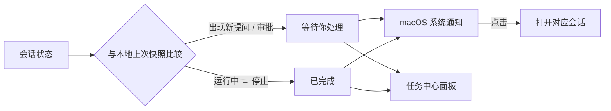

# dsh-task-center

**把「哪个项目在跑什么、哪个 Agent 在等你」收进侧边栏一个入口，需要你时直接弹 macOS 系统通知。**

[DeepSeek Harness](https://github.com/deepseek-ai/deepseek-harness)（简称 DSH）插件 ·
[English](README.en.md) · MIT License


---

## 它解决什么

同时开几个项目干活时，DSH 的会话是按 WorkSpace（项目目录）分组的。于是经常出现这三件事：

1. **忘了刚才在哪个项目。** 十几个项目并列在侧边栏，刚刚那个会话藏在自己项目的折叠组里，翻回去要一层层找。
2. **Agent 停下来等你，你却不知道。** 它发出提问、审批或计划确认后整轮就挂在那里；侧边栏对应的会话只有一颗很小的圆点，你在别的项目、别的 App 里，任务就静默卡住了。
3. **任务跑完了没人告诉你。** 切回来才发现几分钟前就结束，中间一直空等。

这个插件把「正在运行 / 正在等你 / 刚结束」三种状态抽出来，放到一个跨项目的入口里；并且在你离开时用 macOS 通知主动叫你，点通知直接回到那个会话。

## 功能

### 1. 侧边栏「任务中心」入口

位于侧边栏底部、设置按钮上方。

- 右侧数字 = **正在等你处理**的会话数；没有等待时不显示数字。
- 侧边栏折叠成 56px 图标栏时，变成一个带小圆点的图标。
- 面板按三组列出**全部项目**的会话：

| 分组 | 含义 |
| --- | --- |
| 等待你处理 | Agent 正在等你回答、批准或确认计划 |
| 正在运行 | Agent 正在干活 |
| 30 分钟内完成 | 已结束、**未读**、且结束时间在 30 分钟内 |

每行显示：会话标题 · 所属项目 · 最近活动时间 · 状态。点击任意一行，用与侧边栏完全相同的导航动作跳到该会话，面板随即关闭。

「30 分钟内完成」里的条目点开即视为已读并从列表消失——避免已完成的任务越堆越多。

### 2. macOS 系统通知

只要某个会话**开始等你**（提问 / 审批 / 计划确认）或**一轮运行结束**，就发一条系统通知：

- 标题是原因（例如「Agent 在等你回答」「任务已完成」）。
- 正文是「会话标题 · 项目名」。
- **点击通知**会把应用带到前台并直接打开那个会话。
- 同一会话的新通知会替换旧横幅，不会堆叠。
- 包括你当前正在看的会话也会通知（按使用习惯做的默认；侧边栏与面板本身仍然可用作不打扰的视图）。

只有页面**完全没有通知权限**时，才退回右下角的页内卡片（15 秒消失、最多 3 张、点击同样跳转）。

### 3. 项目按最近活动排序

打开开关后，侧边栏的项目顺序跟着「最近有活动的会话」走：你刚干过活的项目浮到最上面，长期没动的沉下去。开关在面板底部，选择记在本地。

- 只移动真正错位的工作区，顺序已正确时**零写入**。
- 如果 Host 坚持另一个顺序，插件试两次后暂停一分钟，不会反复拉扯。
- 关掉开关即停止排序（保留当前顺序）；开着时手动拖动会被下一次活动覆盖。

### 4. 界面

照 macOS 的观感做的：SF 系统字体栈、半透明材质（`backdrop-filter`）、内嵌分组卡片与 0.5px 发丝分隔线、iOS 风格开关、160ms 缓入动画，并尊重「减少动态效果」。配色全部走 DSH 主题 token，深浅色都跟随宿主。

## 安装

要求：DSH **Desktop** 版（本文在 `0.2.2-rc.3` + macOS 上验证过）。

1. 下载或克隆本仓库到任意目录。
2. 打开 DSH **设置 → Plugins → Add plugin**，选择这个目录（含 `package.json` 的那一层）。
3. 安装完成后**重启 DSH**（或刷新页面）加载插件。
4. 侧边栏底部出现「任务中心」。

> 本仓库本身就是一个 DSH bundle：`package.json` 声明 `dsh.bundle.patch`，`cordis.patch.yml` 插入插件行，`client.js` 是浏览器半边，`index.js` 是 Host 半边（空实现）。

**卸载**：设置 → Plugins 中停用或移除 `dsh-task-center`；入口与通知随之消失，DSH 本体不受影响。

## macOS 通知设置

macOS 有个容易踩的坑：**应用只有请求过通知，才会出现在「系统设置 → 通知」的列表里**。从没请求过的应用在那里是找不到的。

1. 装好插件后，随便让一个任务跑完（触发第一条提醒）。系统会询问，或直接发送。
2. 打开 **系统设置 → 通知 → DeepSeek Harness**，确认「允许通知」开启。
3. 面板底部那一行会显示当前状态：**已允许 / 待授权 / 已拒绝（改用页内提醒）/ 当前环境不支持**。

注意事项：

- 应用位于前台时，macOS 可能不画横幅（系统认为你已经在看）。提醒仍会进入通知中心，可在那里回看。
- 提醒样式为「临时」时横幅只短暂停留；想停留更久可在系统设置里改成「持续」。

## 工作原理



插件只读三个**客户端已有**的数据源，不写会话日志、不改工具、不改系统提示：

| 来源 | 用途 |
| --- | --- |
| 会话列表（标题 / 工作区 / 最近活动时间） | 标题、项目名、排序 |
| 会话状态（运行中 / 待处理交互 / 未读完成） | 分组与角标 |
| 工作区快照（项目顺序 / 归档集合） | 项目名、隐藏归档、排序目标 |

几个刻意的设计选择：

- **完成判定不依赖 DSH 的未读标记**，而是自己比较「上次快照里在运行 → 这次不在运行」。未读标记只用来决定是否留在「30 分钟内完成」分组，这样即使某个会话没被标记未读，也不会漏掉提醒。
- **首次加载只建立基线**：页面打开时已经存在的提问与完成不会批量补发通知，避免刷屏。
- **进度不轮询**：全部由客户端快照变化驱动，没有定时扫描会话或模型调用。

## 支持性与兼容性

| 环境 | 状态 |
| --- | --- |
| DSH `0.2.2-rc.3` Desktop（Electron）+ macOS 26 | ✅ 已验证 |
| DSH Web（浏览器直接打开 `127.0.0.1` 端口） | ⚠️ 可用；通知取决于浏览器授权，被拒时降级为页内卡片 |
| Windows / Linux | ❓ 未验证（方案层面可行，通知实现依赖各平台） |

依赖的 DSH 客户端契约（DSH 升级后如发生变化，表现为入口消失或功能不可用，不会影响 DSH 本体）：

- 两个 slot：`sidebar.footer.action`、`shell.overlay`
- 三个标准 hook：`useSessions`、`useSessionStatus`、`useWorkspaces`
- 导航：`uiWorkspace.openSession(sessionId)`
- 项目排序：`workspaces.insertBefore(id, beforeId)`
- 浏览器 Notification API（由 Desktop 外壳放行非 media 权限）

## 限制

- 只在本页面打开期间有效；页面关闭或应用退出期间发生的活动**不会补发**通知（打开后仍能看到当前状态）。
- 空白新会话、已归档会话、子代理子会话不列出、不通知；子代理的活动体现在父会话。
- 「已完成」的时间用会话最后一次活动时间近似。
- 当前会话也会通知（这是刻意选择）。
- 侧边栏折叠态只显示圆点，不显示数字。

## 隐私

- 不发起任何网络请求，不上传任何内容。
- 只读本机上 DSH 客户端已有的内存快照。
- 本地唯一的持久化是「项目排序开关」这一个偏好（`localStorage`，键名 `dsh.task-center.workspace-sort`）。
- 通知内容在本机生成。

## 可配置项（当前硬编码）

这些值写在 `client.js` 顶部，按需自行修改（后续会考虑抽成插件 Config）：

| 常量 | 默认 | 含义 |
| --- | --- | --- |
| `COMPLETED_WINDOW_MS` | 30 分钟 | 「已完成」分组保留时长 |
| `TOAST_MS` | 15 秒 | 页内兜底卡片存活时间 |
| `MAX_TOASTS` | 3 | 页内兜底卡片上限 |
| 排序默认值 | 开启 | 面板底部开关可切换 |

## 开发

```
.
├── package.json          # 插件清单：dsh.bundle / dsh.client 声明、exports、files
├── cordis.patch.yml      # 插入插件行
├── index.js              # Host 半边（空实现）
├── client.js             # 浏览器半边：入口、面板、通知、排序（全部逻辑）
├── locale/en.json        # 插件显示名与描述（英文）
├── locale/zh.json        # 插件显示名与描述（中文）
├── icon.svg              # 插件图标
├── README.md / README.en.md
└── .github/workflows/ci.yml
```

本地校验（不需要装依赖）：

```sh
node --check index.js
node --check client.js
node -e "JSON.parse(require('node:fs').readFileSync('locale/en.json','utf8'))"
```

本地安装：Plugins → Add plugin → 选择本目录。改完代码后刷新页面（或重启应用）即可看到效果；`client.js` 是纯 JS，无需构建。

**发版时记得同步三处版本号**：`package.json` 的 `version`、`client.js` 顶部的 `VERSION`（面板底部显示它，用于排查实际加载的版本）、git tag。

## License

[MIT](LICENSE) © 2026 daishaodong
